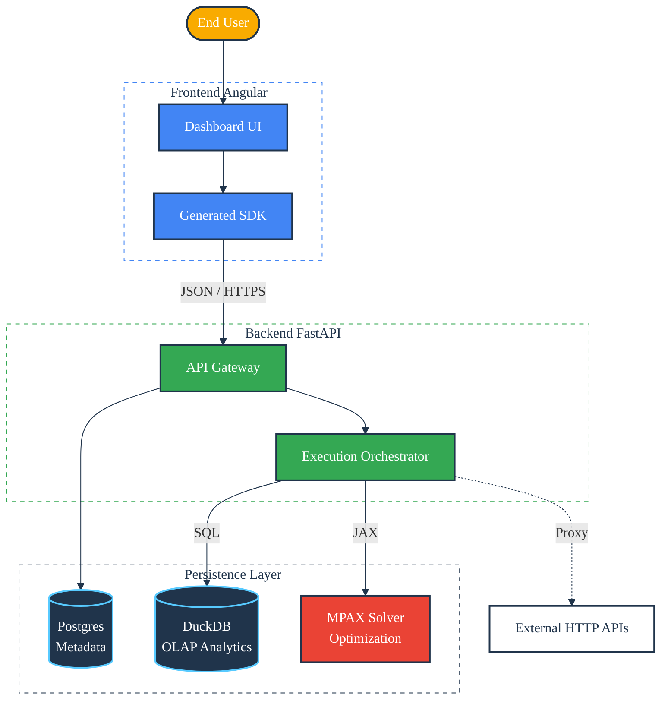

Pulse Query: Hospital Analytics Platform
========================================

[](https://opensource.org/licenses/Apache-2.0)
[](https://github.com/SamuelMarks/hospital-dashboard-platform/actions/workflows/ci-pipeline.yml)
 

> **Purpose:** This file serves as the main entry point for the Pulse Query repository, providing a high-level overview of the platform, its key features, and initial setup instructions for developers.

**Pulse Query** is an enterprise-grade hospital analytics platform designed to bridge the gap between operational data (EHR logs) and strategic decision-making (Capacity Planning).

It features a **Split-Stack Architecture** that combines the strict typing of a modern Angular frontend with the raw analytical power of DuckDB and the mathematical optimization capabilities of JAX/MPAX on the backend.

---

## 🏗️ Architecture

The system uses a decoupled interaction model where the Frontend communicates exclusively via a REST API. The Backend acts as an orchestration layer, routing requests to either a transactional metadata store (PostgreSQL), an analytical engine (DuckDB), or a mathematical solver (MPAX).



### Core Components

1.  **Dual-Database Strategy**:
    - **PostgreSQL**: Manages application state (Users, Dashboards, Widgets, Templates).
    - **DuckDB**: High-performance OLAP engine for querying hospital CSV data directly.
2.  **MPAX / JAX Solver**: Performs linear programming optimization for "What-If" capability planning scenarios (e.g., maximizing bed utilization under constraints).
3.  **Strictly Typed Frontend**: An Angular application that generates its entire API client layer from the Backend's OpenAPI specification, ensuring contract reliability.

---

## ✨ Key Features

- **📊 Dynamic Dashboards**: Build responsive dashboards with grids of widgets powered by DuckDB SQL or external HTTP APIs.
- **🤖 AI Assistant**: Natural‑language to SQL generation with multi‑model candidate outputs and human selection.
- **🏟️ LLM Arena Analytics**: Inspect which user queries generated which SQL, by which LLM, and how each candidate was scored/selected.
- **🧪 Experiment Logs**: `/api/v1/ai` experiment runs are captured alongside chat arena results for unified analysis and comparison.
- **🔎 SQL Preview for Candidates**: Execute candidate SQL against the preview endpoint to compare results before selecting.
- **🧰 Query Cart**: Stage ad‑hoc SQL and drag it into dashboards for rapid iteration and collaboration.
- **🧩 Template Marketplace**: Pre‑packaged analytics templates ("Utilization Spikes", "Seasonal Growth") with parameterized inputs.
- **📐 Widget Builder**: Configure SQL widgets, HTTP‑backed widgets, and text/markdown summaries in one flow.
- **🔮 Simulation & Optimization**: Run complex scenarios to optimize patient‑to‑bed allocation using mathematical solvers.
- **🛡️ Analytical Security**: AST‑based SQL validation ensures only safe `SELECT` and `CTE` queries are executed.
- **🔗 Contract‑First Frontend**: OpenAPI‑generated Angular client ensures frontend/pulse-query-backend schema consistency.

---

## 🚀 Getting Started

### Prerequisites

- **Native (Non-Docker) Mode**:
  - **Python 3.12+** & **uv** (`curl -LsSf https://astral.sh/uv/install.sh | sh`)
  - **Node.js 22+** & **NPM**
  - **PostgreSQL 18+** & **DuckDB** (can be auto-installed via LibScript with `make install_base` / `make install_db`)
- **Docker Mode**:
  - **Docker** & **Docker Compose**

---

### `Makefile` & `make.bat` Usage Guide

Both POSIX (`Makefile`) and Windows (`make.bat`) provide 100% target parity across **Native (Non-Docker)** and **Docker** workflows for the **Database** (PostgreSQL 18 + DuckDB), **Backend** (FastAPI), and **Frontend** (Angular + OpenAPI SDK).

#### Common Workflows

```bash
# --- Full Native (Non-Docker) Workflow ---
make setup_native     # Install runtimes, create .venv/.env, install deps, init/migrate/seed DB, and build
make run_native       # Start the full stack natively (via LibScript or FastAPI static server on :8000)
make test_native      # Run backend pytest and frontend unit tests natively
make clean_native     # Remove local build and test artifacts

# --- Full Docker Workflow ---
make setup_docker     # Build images, start PostgreSQL container, run Alembic migrations, and seed DuckDB/Postgres
make run_docker       # Start db (:5433), backend (:8000), and frontend (:4200) containers
make test_docker      # Run backend pytest and frontend unit tests inside containers
make clean_docker     # Stop and remove containers and persistent volumes
```

> **Windows CMD / PowerShell:** Replace `make <target>` with `.\make.bat <target>` (e.g., `.\make.bat setup_native`, `.\make.bat setup_docker`).

#### Complete Target Reference Table

| Category              | Target            | Mode   | Equivalent Command (`Makefile` / `make.bat`)        | Description                                                                                         |
| :-------------------- | :---------------- | :----- | :-------------------------------------------------- | :-------------------------------------------------------------------------------------------------- |
| **Unified Lifecycle** | `help`            | Both   | `make help` / `make.bat help`                       | Display all available targets grouped by tier and mode                                              |
| **Unified Lifecycle** | `setup`           | Native | `make setup` / `make.bat setup`                     | Alias for `setup_native`                                                                            |
| **Unified Lifecycle** | `setup_native`    | Native | `make setup_native` / `make.bat setup_native`       | End-to-end native setup: `install_base` → `install_deps` → `setup_db` → `build`                     |
| **Unified Lifecycle** | `run_native`      | Native | `make run_native` / `make.bat run_native`           | Run full stack natively (`libscript start` if available, else `serve`)                              |
| **Unified Lifecycle** | `test_native`     | Native | `make test_native` / `make.bat test_native`         | Alias for `test` (runs native backend + frontend test suites)                                       |
| **Unified Lifecycle** | `clean_native`    | Native | `make clean_native` / `make.bat clean_native`       | Remove `dist/`, `.angular/`, `.pytest_cache/`, `.coverage`, and `docs/`                             |
| **Unified Lifecycle** | `setup_docker`    | Docker | `make setup_docker` / `make.bat setup_docker`       | End-to-end Docker setup: `build_docker` → `setup_db_docker`                                         |
| **Unified Lifecycle** | `build_docker`    | Docker | `make build_docker` / `make.bat build_docker`       | Build all Docker Compose service images                                                             |
| **Unified Lifecycle** | `run_docker`      | Docker | `make run_docker` / `make.bat run_docker`           | Start all Docker Compose services (`db`, `backend`, `frontend`)                                     |
| **Unified Lifecycle** | `test_docker`     | Docker | `make test_docker` / `make.bat test_docker`         | Execute `pytest` and `npm run test -- --watch=false` inside Docker containers                       |
| **Unified Lifecycle** | `clean_docker`    | Docker | `make clean_docker` / `make.bat clean_docker`       | Tear down Docker Compose containers and named volumes (`down -v`)                                   |
| **Database**          | `install_db`      | Native | `make install_db` / `make.bat install_db`           | Install native PostgreSQL 18 and DuckDB via LibScript                                               |
| **Database**          | `init_db`         | Native | `make init_db` / `make.bat init_db`                 | Create native PostgreSQL database (`pulse_query_db`) and user role if missing                       |
| **Database**          | `migrate_db`      | Native | `make migrate_db` / `make.bat migrate_db`           | Bootstrap `.env` from `.env.tpl` and run `alembic upgrade head` natively                            |
| **Database**          | `seed_db`         | Native | `make seed_db` / `make.bat seed_db`                 | Ingest clinical CSVs into DuckDB (`ingest.py`) and seed templates (`seed_templates.py`)             |
| **Database**          | `setup_db`        | Native | `make setup_db` / `make.bat setup_db`               | Composite native DB target: `install_db` → `init_db` → `migrate_db` → `seed_db`                     |
| **Database**          | `db_docker`       | Docker | `make db_docker` / `make.bat db_docker`             | Start only the `db` (PostgreSQL 18) container in detached mode                                      |
| **Database**          | `migrate_docker`  | Docker | `make migrate_docker` / `make.bat migrate_docker`   | Run `alembic upgrade head` inside the `backend` container against `db`                              |
| **Database**          | `seed_docker`     | Docker | `make seed_docker` / `make.bat seed_docker`         | Run `scripts/ingest.py` and `scripts/seed_templates.py` inside the `backend` container              |
| **Database**          | `setup_db_docker` | Docker | `make setup_db_docker` / `make.bat setup_db_docker` | Composite Docker DB target: `db_docker` → `migrate_docker` → `seed_docker`                          |
| **Backend**           | `setup_backend`   | Native | `make setup_backend` / `make.bat setup_backend`     | Create `pulse-query-backend/.venv` (via `uv` or `venv`), copy `.env.tpl` → `.env`, and install deps |
| **Backend**           | `build_backend`   | Native | `make build_backend` / `make.bat build_backend`     | Install the FastAPI backend package in editable mode (`pip install -e .`)                           |
| **Backend**           | `dev_backend`     | Native | `make dev_backend` / `make.bat dev_backend`         | Start FastAPI dev server with hot reload on `http://localhost:8000`                                 |
| **Backend**           | `backend_docker`  | Docker | `make backend_docker` / `make.bat backend_docker`   | Build and start the `db` and `backend` containers via Docker Compose                                |
| **Frontend**          | `setup_frontend`  | Native | `make setup_frontend` / `make.bat setup_frontend`   | Install Angular dependencies (`npm install --legacy-peer-deps`) in `pulse-query-ng-web`             |
| **Frontend**          | `generate_client` | Native | `make generate_client` / `make.bat generate_client` | Extract backend OpenAPI schema and generate Angular & KMP client SDKs                               |
| **Frontend**          | `build_frontend`  | Native | `make build_frontend` / `make.bat build_frontend`   | Build the Angular production bundle (`pulse-query-ng-web/dist`)                                     |
| **Frontend**          | `dev_frontend`    | Native | `make dev_frontend` / `make.bat dev_frontend`       | Start Angular dev server with API proxy on `http://localhost:4200`                                  |
| **Frontend**          | `frontend_docker` | Docker | `make frontend_docker` / `make.bat frontend_docker` | Build and start the `frontend` container via Docker Compose                                         |
| **Shared & Quality**  | `install_base`    | Native | `make install_base` / `make.bat install_base`       | Install Python 3.12, Node.js 22, uv, PostgreSQL 18, and DuckDB via LibScript                        |
| **Shared & Quality**  | `install_deps`    | Native | `make install_deps` / `make.bat install_deps`       | Composite dependency target: `setup_backend` → `setup_frontend`                                     |
| **Shared & Quality**  | `build`           | Native | `make build` / `make.bat build`                     | Composite build target: `build_frontend` → `build_backend`                                          |
| **Shared & Quality**  | `serve`           | Native | `make serve` / `make.bat serve`                     | Build frontend if needed and serve static UI + API from FastAPI (`DEBUG=1` on `:8000`)              |
| **Shared & Quality**  | `build_docs`      | Native | `make build_docs` / `make.bat build_docs`           | Enforce 100% doc coverage (`interrogate` + `compodoc`/TSDoc) and generate docs                      |
| **Shared & Quality**  | `test`            | Native | `make test` / `make.bat test`                       | Run backend `pytest` and frontend `npm run test -- --watch=false`                                   |
| **Shared & Quality**  | `fmt`             | Native | `make fmt` / `make.bat fmt`                         | Format Python (`ruff format .`) and TypeScript/HTML (`npm run format`)                              |
| **LibScript Stack**   | `start_stack`     | Native | `make start_stack` / `make.bat start_stack`         | Start the declarative LibScript stack (`libscript.json`)                                            |
| **LibScript Stack**   | `stop_stack`      | Native | `make stop_stack` / `make.bat stop_stack`           | Stop the declarative LibScript stack                                                                |
| **LibScript Stack**   | `status_stack`    | Native | `make status_stack` / `make.bat status_stack`       | Check process status of the declarative LibScript stack                                             |
| **LibScript Stack**   | `health_stack`    | Native | `make health_stack` / `make.bat health_stack`       | Run HTTP/TCP health checks on the declarative LibScript stack                                       |
| **LibScript Stack**   | `logs_stack`      | Native | `make logs_stack` / `make.bat logs_stack`           | Tail service logs for the declarative LibScript stack                                               |
| **LibScript ML**      | `train_ml`        | Native | `make train_ml` / `make.bat train_ml`               | Run MPAX benchmark scenario generation and arena evaluation via LibScript                           |
| **LibScript ML**      | `infer_ml`        | Native | `make infer_ml` / `make.bat infer_ml`               | Run MPAX arena scoring and report generation via LibScript                                          |

#### Configurable Makefile Variables

| Variable             | Default                                               | Description                                                      |
| :------------------- | :---------------------------------------------------- | :--------------------------------------------------------------- |
| `COMPOSE_FILE`       | `docker-compose.yml`                                  | Docker Compose manifest path used by `*_docker` targets          |
| `DOCS_DIR`           | `docs`                                                | Output directory for generated documentation (`make build_docs`) |
| `LIBSCRIPT_ROOT_DIR` | `~/repos/libscript` (`%USERPROFILE%\repos\libscript`) | Root directory of the LibScript installation                     |
| `POSTGRES_HOST`      | `localhost`                                           | Native PostgreSQL hostname for `init_db`                         |
| `POSTGRES_PORT`      | `5432`                                                | Native PostgreSQL port for `init_db`                             |
| `POSTGRES_USER`      | `postgres`                                            | Native PostgreSQL superuser/owner for `init_db`                  |
| `POSTGRES_PASSWORD`  | `postgres`                                            | Native PostgreSQL password for `init_db`                         |
| `POSTGRES_DB`        | `pulse_query_db`                                      | Native PostgreSQL database name for `init_db`                    |

---

### 1. Step-by-Step Backend & Database Setup

The backend handles PostgreSQL metadata persistence, DuckDB analytical ingestion, and API serving.

```bash
# Option A: Using Makefile (Native)
make setup_backend
make setup_db
make dev_backend

# Option B: Using Makefile (Docker)
make setup_docker
make backend_docker

# Option C: Manual Step-by-Step
cd pulse-query-backend

# 1. Start Infrastructure (Postgres via Docker or local service)
docker compose up -d db

# 2. Install Dependencies
uv sync

# 3. Apply Database Migrations (Postgres Schema)
uv run alembic upgrade head

# 4. Ingest Sample Data (DuckDB) & Seed Templates (Postgres)
uv run python3 ./scripts/ingest.py
uv run python3 ./scripts/seed_templates.py

# 5. Ingest Model List
# Load model list from ollama and env keys (like `OPENAI_API_KEY`, `GOOGLE_API_KEY`)
uv run python3 ./scripts/update_models.py

# 6. Start the Server
uv run uvicorn --app-dir src app.main:app --reload --port 8000
```

_API runs at `http://localhost:8000` (Swagger Docs at `/docs`)_

### 2. Step-by-Step Frontend Setup

The frontend is an Angular application with a strictly typed OpenAPI client SDK.

```bash
# Option A: Using Makefile (Native)
make setup_frontend
make generate_client
make dev_frontend

# Option B: Using Makefile (Docker)
make frontend_docker

# Option C: Manual Step-by-Step
# 1. Generate API Client (extracts openapi.json and builds TypeScript + KMP clients)
./generate_client.sh

# 2. Install Node Dependencies
cd pulse-query-ng-web
npm install --legacy-peer-deps

# 3. Run Development Server
npm start
```

_UI runs at `http://localhost:4200`_

### 3. Declarative Full-Stack Orchestration (LibScript)

This repository includes a unified `libscript.json` manifest that declaratively provisions runtimes (`python 3.12`, `nodejs 22`, `uv`), databases (`postgres 18`, `duckdb`), reverse proxy ingress (`nginx` with SPA fallback and `/ws` WebSocket upgrades), frontends (Angular 19 web and Kotlin Multiplatform Compose), background services, and JAX/MPAX machine learning benchmarks:

```bash
# Resolve and install dependencies, provision databases, and run lifecycle hooks
~/repos/libscript/libscript.sh install-deps libscript.json

# Manage the application stack (or via `make start_stack`, `make stop_stack`, etc.)
~/repos/libscript/libscript.sh start libscript.json
~/repos/libscript/libscript.sh status libscript.json
~/repos/libscript/libscript.sh health libscript.json
~/repos/libscript/libscript.sh logs libscript.json
~/repos/libscript/libscript.sh stop libscript.json

# Execute JAX/MPAX benchmark evaluation and scoring via declarative ML verbs
~/repos/libscript/libscript.sh train libscript.json
~/repos/libscript/libscript.sh infer libscript.json

# Run end-to-end verification (mock cloud dry-run or live multi-cloud deployment)
./test.sh --unit-mock
```

See [DEPLOY.md](DEPLOY.md) for comprehensive multi-cloud (Azure, AWS, GCP) and TPU/GPU accelerator deployment guides.

---

## 🛠️ Maintenance & Development

This project uses **Contract-First Development**.

- **Backend Changes**: If you modify Pydantic schemas or API routes in FastAPI, you **must** run `make generate_client` (or `./generate_client.sh`) to update the Frontend SDK.
- **Data Updates**: To reset the analytical data, delete `pulse-query-backend/hospital_analytics.duckdb` and re-run `make seed_db` (or `uv run python scripts/ingest.py`).
- **Testing & Quality**:
  - Full Test Suite (Native): `make test_native` (or `make test`)
  - Full Test Suite (Docker): `make test_docker`
  - Documentation & 100% Doc Coverage Verification: `make build_docs`
  - Code Formatting: `make fmt`
  - E2E: `npx playwright test` (Requires running `pulse-query-backend` and `pulse-query-ng-web`)

See [MAINTENANCE.md](MAINTENANCE.md) for detailed contribution guides.

---

## 📄 License

This project is licensed under the Apache 2.0 License - see the [LICENSE](LICENSE) file for details.
